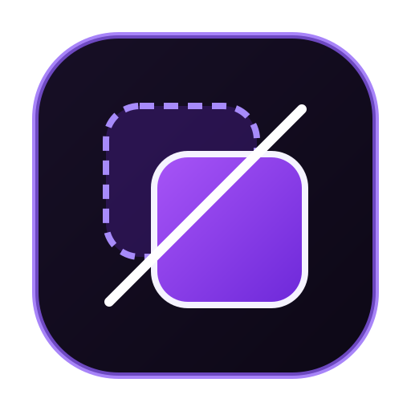
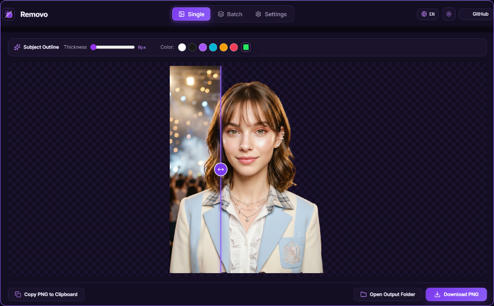
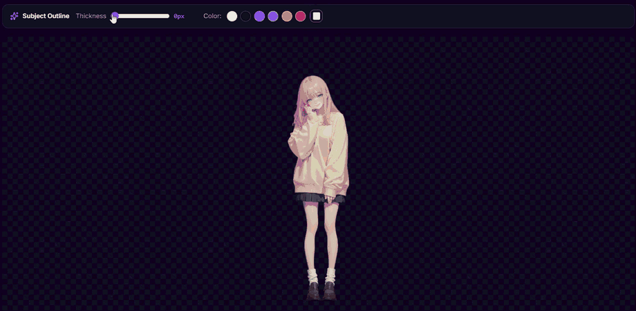
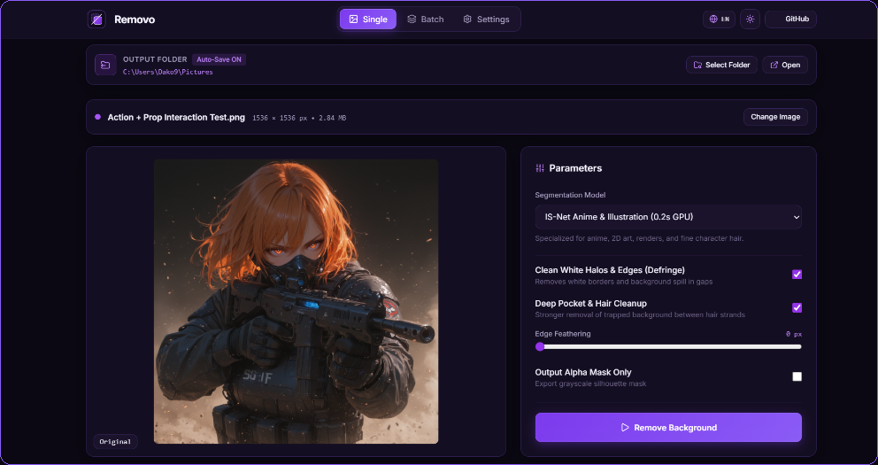
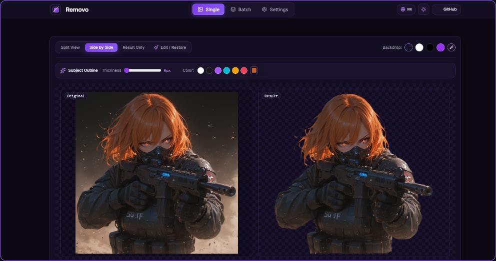
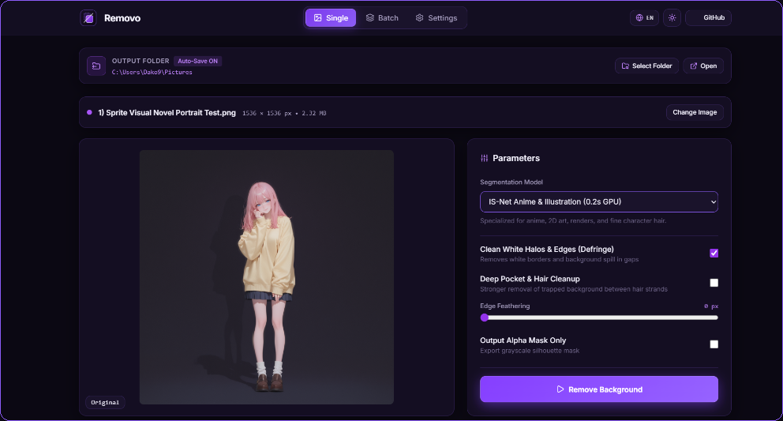

# Removo

<div align="center">
  
  <br>
  <p><strong>Local GPU-accelerated background removal and cutout refinement desktop utility.</strong></p>

  [](LICENSE)
  [](https://www.python.org/)
  [](https://fastapi.tiangolo.com/)
  [](https://onnxruntime.ai/)
</div>

---

## Preview & Live Workflow

### Interactive Split Comparison
Inspect fine hair strands and complex edges using the static split-view slider, backdrop color swatches, and one-click clipboard export.

<div align="center">
  
</div>

---

### Real-Time Subject Outline (Stroke)
Add customizable contour strokes (`0–36 px`) with instant color presets or custom colors directly over your cutout, and save the outlined PNG to your output folder.

<div align="center">
  
</div>

---

### Staging, Model Parameters & Side-by-Side Inspection
Images are staged upon upload or clipboard paste (`Ctrl + V`) without automatic execution, allowing you to configure the segmentation model and edge cleanup options before rendering.

| 1. Staging & Model Parameters | 2. Side-by-Side Result View |
| :---: | :---: |
|  |  |

<div align="center">
  
</div>

---

## Key Features

- **GPU-Accelerated Segmentation Models:**
  - `isnet-general-use` (IS-Net General) — Ultra-fast general-purpose segmentation for photos, people, and products (~0.3s on GPU).
  - `isnet-anime` (IS-Net Anime & Illustration) — High-precision segmentation for 2D art, visual novel sprites, and fine character hair (~0.2s on GPU).
  - `bria-rmbg` (BRIA RMBG-1.4) — Studio-grade commercial segmentation model (~3s on GPU).
  - `birefnet-general-lite` (BiRefNet Lite) — High-resolution bilateral reference network for intricate contours.
- **Smart Edge Decontamination (Defringe):**
  - Automatically removes background color spill and trapped background pockets while preserving white foreground details.
- **Fullscreen Interactive Brush Editor (Restore & Erase):**
  - **Restore** missing details from the original image or **Erase** unwanted regions using soft or hard brushes.
  - **Original Guide** overlay to inspect the source image underneath transparent areas while painting.
  - **Cursor-Anchored Wheel Zoom** (scroll wheel to zoom directly toward the pointer), **Right-Click / Spacebar Drag** to pan, **`Alt + Wheel`** to resize the brush, and **Undo / Redo (`Ctrl + Z` / `Ctrl + Y`)**.
- **Post-Generation Subject Outline:**
  - Customizable contour stroke with adjustable thickness (`0–36 px`), color presets, and custom color picker, visible live in both the preview views and the brush editor.
- **Manual Execution & Auto-Save Workflow:**
  - Automatically writes processed and edited outputs to your configured Output Folder, prompting with a native directory selector if none is set.
- **Themes & Localization:**
  - Dark Purple and Light Purple themes.
  - Built-in English (default) and Spanish interface localization.

---

## Project Structure

```text
Removo/
├── assets/
│   ├── screenshots/            # Application workflow previews and demos
│   ├── app.ico                 # Multi-resolution Windows icon
│   ├── logo.png                # Raster application icon
│   └── logo.svg                # Vector application logo
├── backend/
│   ├── engine.py               # DirectML GPU / ONNX session manager and edge decontamination
│   └── server.py               # FastAPI endpoints, native folder selector, and auto-save
├── frontend/
│   ├── index.html              # Application layout (Single, Batch, Settings, Editor Overlay)
│   ├── style.css               # Dark & Light purple themes
│   └── app.js                  # Brush editor, subject outline, i18n, and state controller
├── create_desktop_shortcut.py  # Creates a Windows desktop shortcut
├── generate_assets.py          # Generates application icons
├── launch.bat                  # Command-line launcher
├── Removo.vbs                  # Windowless desktop launcher
├── main.py                     # Server entrypoint and native app-mode window launcher
└── requirements.txt            # Python dependencies
```

---

## Getting Started

### Prerequisites

- Python 3.10+
- Windows 10/11 (with Edge, Chrome, or Brave for standalone `--app` window mode)
- DirectX 12 compatible GPU (NVIDIA, AMD, or Intel) recommended for hardware acceleration (CPU fallback supported)

### Installation

```bash
git clone https://github.com/Diego-Villanueva-v/Removo.git
cd Removo
pip install -r requirements.txt
```

### Running the Application

```bash
python main.py
```

To create a shortcut on your Windows Desktop:

```bash
python create_desktop_shortcut.py
```

---

## License

Released under the [MIT License](LICENSE). Created by [Diego Villanueva](https://github.com/Diego-Villanueva-v).
